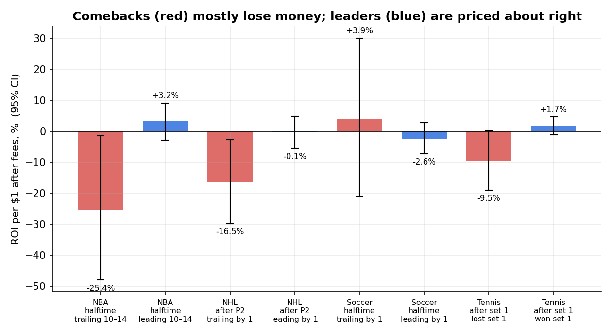

# polymarket-sports-edge

Research + paper-trading bot that looks for **in-play mispricing on Polymarket sports markets**.
Built end-to-end: data collection from public APIs, backtests on *executable* prices, and a 24/7 bot on a VPS
with Telegram alerts.

**Short version of the findings:** in-play sports markets on Polymarket are efficient. Betting on comebacks
loses money in NBA, NHL and tennis; leaders are priced about right. The one surviving candidate —
*a tennis underdog who wins the first set* — is being forward-tested.

📊 **Full research report with charts: [`RESEARCH.md`](RESEARCH.md)** · quick tables: [`results/RESULTS.md`](results/RESULTS.md)



## Why this project is interesting

- **Honest methodology.** Started from a hypothesis (NBA halftime comebacks are under-priced), tested it, and it
  failed on real data. Caught a data artifact (mid-prices of empty order books) that produced a fake +13% edge.
- **Real execution prices.** Backtests use VWAP of actual taker buys from the Polymarket trades API, not quotes.
- **Correlation-aware stats.** Bootstrap confidence intervals resampled by game; one-bet-per-game checks.
- **~7 400 games** across 4 sports, matched to play-by-play from ESPN to know the exact game state.

## Repository

```
bot/                     live paper-trading bot (NBA halftime + tennis after set 1)
  bot.py                 main loop, signals, sizing, take-profit, settlement, Telegram, report
  livecheck.py           checks wallet / API connection without placing orders
  games.csv              4 seasons of NBA halftime history used for fair-probability estimates
  pm-bot.service         systemd unit
research/
  nba_espn_backtest/     4 NBA seasons (ESPN play-by-play): comeback rates by halftime gap
  polymarket_nba/        NBA: game state from ESPN + real Polymarket trades at halftime
  multisport/            NHL, soccer (6 leagues), tennis (big tournaments)
results/RESULTS.md       all result tables
results/make_charts.py   builds the charts in results/img/
RESEARCH.md              full research report
```

## Bot

- Polls ESPN live scores (NBA) and Polymarket markets (tennis).
- **NBA:** at halftime, if a pre-game-even/favourite team trails by 10–19, compares the order-book ask
  (+ fee) with a conservative historical probability (point estimate − 1 SE); bets only with edge ≥ 3 pp.
- **Tennis:** when the "Set 1 Winner" market reaches 0.97 and the winner was a pre-match underdog (< 40%),
  buys that player's match moneyline within 4 minutes.
- Fixed 5% of bankroll per bet, Polymarket min order size, liquidity cap at best ask,
  +25% take-profit, daily bet limits and stop-loss.
- Settles NBA by ESPN final score and tennis by Polymarket market resolution; logs both "with TP" and
  "hold to end" PnL so the take-profit rule can be evaluated.
- Paper mode by default (`LIVE=0`). SQLite journal, Telegram notifications, `python bot.py report`.

```bash
cd bot
python -m venv venv && source venv/bin/activate
pip install -r requirements.txt
cp .env.example .env          # set TG_BOT_TOKEN / TG_CHAT_ID if you want alerts
python bot.py selftest        # API connectivity check
python bot.py run             # paper mode
python bot.py report
```

## Reproducing the research

```bash
# NBA on real Polymarket trades
cd research/polymarket_nba && python collect.py && python trades.py && python analyze2.py
# NHL / soccer / tennis
cd research/multisport && python ms_fetch_events.py && \
  python ms_collect.py nhl && python ms_collect.py soccer && python ms_collect.py tennis && python ms_analyze.py
```

Data sources: Polymarket Gamma, CLOB and Data APIs; ESPN public site API. No API keys needed for research.

## Stack

Python · pandas / numpy · requests · SQLite · py-clob-client-v2 · systemd on an Ubuntu VPS · Telegram Bot API

## Disclaimer

Research and paper trading only. Not financial advice. Prediction-market access is restricted in some
jurisdictions — follow Polymarket's terms of use for your location.

---

*Русская версия кратко:* исследование и paper-бот для лайв-ставок на Polymarket. Проверены НБА, НХЛ, футбол и теннис
(~7 400 матчей, цены реальных сделок): ставки на камбэк везде в минусе, лидеры оценены честно. Единственный кандидат —
андердог, выигравший первый сет в теннисе, — тестируется ботом.
