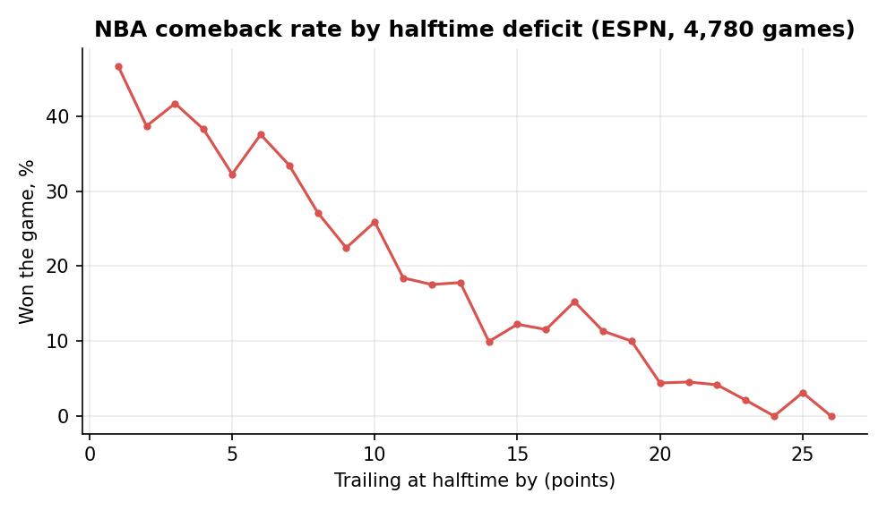
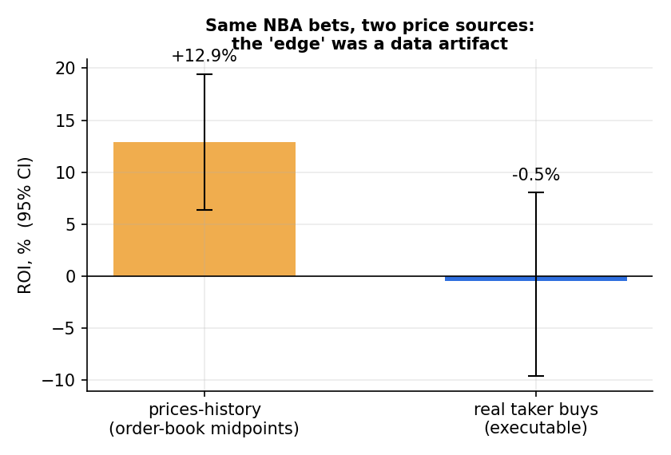
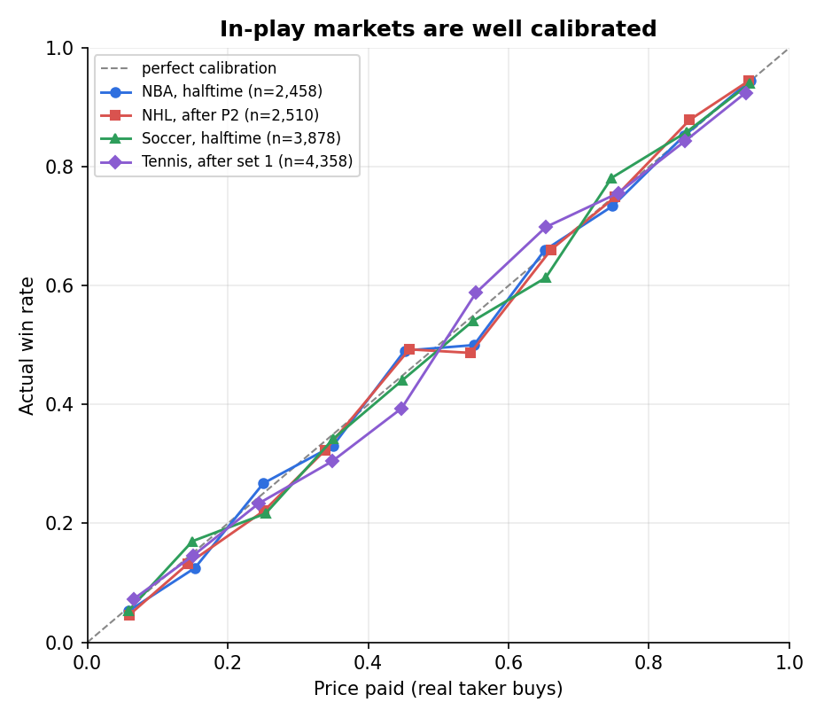
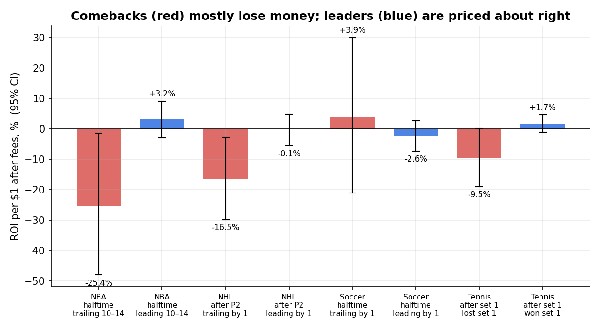
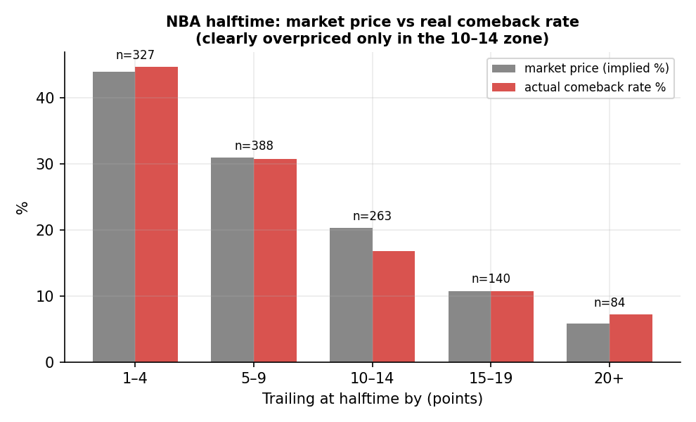
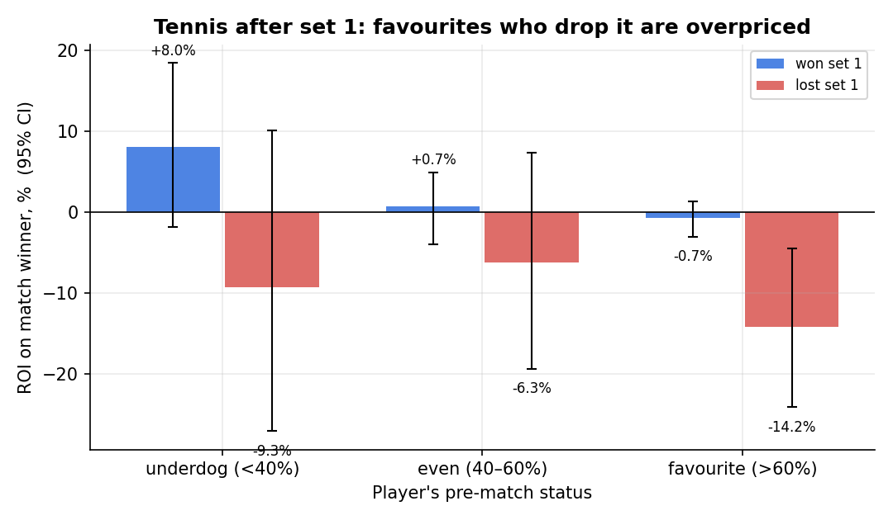

# Are in-play sports markets on Polymarket mispriced?

*A research report on ~7,400 games across NBA, NHL, European soccer and tennis.*

**TL;DR.** In-play sports markets on Polymarket are well calibrated. Betting on **comebacks** loses money
in almost every slice tested; betting on **leaders** returns roughly zero after costs. The only candidate
edge — a **tennis underdog who wins the first set** (+8%, CI −2…+18%) — is now being forward-tested by the bot.
An apparent +13% edge on NBA spreads turned out to be a **data artifact** of illiquid order books.

---

## 1. Question

The project started from a betting intuition: *"when two even NBA teams split apart by 10–19 points at
halftime, the market overreacts and the trailing team is too cheap."*

That turned into three research questions:

1. How often do teams actually come back, by halftime deficit? (historical base rates)
2. Does Polymarket price those situations correctly? (market vs. reality)
3. Does any simple in-play rule make money **after fees, at prices you could actually trade at?**

## 2. Data

| Source | What | Volume |
|---|---|---|
| ESPN public API | NBA play-by-play, 4 regular seasons (2021/22 – 2024/25) | 4,922 games |
| Polymarket Gamma / CLOB / Data APIs + ESPN | NBA 2025/26 + start of 2026/27: game state at halftime and after Q3, real trades | 1,311 games |
| Polymarket + ESPN | NHL 2025/26 + start of 2026/27: state after P1 / P2, real trades | 1,540 games |
| Polymarket + ESPN | Soccer: EPL, LaLiga, Serie A, Bundesliga, Ligue 1, Champions League — halftime | 2,245 games |
| Polymarket | Tennis, Slams + Masters/1000 + Finals: right after set 1 | 2,346 matches |

Game state (score, exact timestamp of halftime / period end) comes from ESPN play-by-play wall clocks.
For tennis the end of set 1 is taken from Polymarket itself: the moment the *"Set 1 Winner"* market
reaches 0.97.



## 3. Methodology

- **Executable prices only.** For each outcome, the price is the volume-weighted average of real
  **taker buys** on Polymarket in a short window right after the snapshot (10 min for halftime /
  intermissions, 4 min after a tennis set). Outcomes with fewer than 20 shares bought are dropped as illiquid.
- **Costs.** A conservative fee of `0.05 · p · (1 − p)` per share is charged on every bet.
- **Metric.** ROI per $1 staked, holding to the end of the game.
- **Uncertainty.** 95% confidence intervals by **bootstrap over games** — several bets inside one game
  are correlated, so resampling individual bets would understate the error.
- **Multiple testing.** Dozens of slices were examined. A single slice with an interval above zero is treated
  as a *hypothesis to forward-test*, not as a finding.

### The artifact that almost fooled the analysis

The first pass used Polymarket's `prices-history` endpoint. On thinly traded in-play spreads it returns
the *midpoint of an almost empty order book* — e.g. 0.74 for an outcome that is close to certain — a
price nobody could actually buy at. Priced that way, betting the leader's spread at NBA halftime looked
like a solid +13% edge. Re-priced with real trades, the same bets return about zero.



## 4. Results

### 4.1 Calibration

Across all four sports, the price paid is a good estimate of the real win frequency. There is no large,
systematic bias in the 0.3–0.9 range. Cheap outcomes (≤ 0.2) tend to under-deliver — the classic
*favourite-longshot bias*.



### 4.2 Comebacks vs. leaders



| Sport | Bet | ROI | 95% CI |
|---|---|---|---|
| NBA, halftime | trailing team by 10–14, moneyline | **−25.4%** | [−48.1; −1.5] |
| NBA, halftime | leading team by 10–14, moneyline | +3.2% | [−3.1; +9.1] |
| NBA, halftime | leader's spread, lead 10+, one bet per game | +4.1% | [−2.4; +10.3] |
| NHL, after P2 | trailing by 1 goal | **−16.5%** | [−29.9; −2.8] |
| NHL, after P2 | trailing, teams even before the game | **−25.7%** | [−41.1; −9.9] |
| NHL, after P2 | leading by 1 / 2 / 3+ | −0.1% / +0.6% / +0.5% | all contain 0 |
| Soccer, halftime | leading by 1 → wins | −2.6% | contains 0 |
| Soccer, halftime | trailing by 2+ → wins | −49% | wide |

**The original hypothesis is rejected.** In the NBA the market already prices comebacks — and in the 10–14
zone it actually *over*prices them:



Soccer is the most efficient market of the four: no slice has an interval above zero, and the
league-by-league spread for "leading by 1 at halftime" (−10% … +9%) is consistent with noise.

### 4.3 Tennis after the first set



| Player | Pre-match status | ROI | 95% CI |
|---|---|---|---|
| Lost set 1 | favourite (> 60%) | **−14.2%** | [−24.2; −4.5] |
| Won set 1 | underdog (< 40%) | **+8.0%** | [−1.9; +18.5] |
| Won set 1 | even / favourite | +0.7% / −0.7% | contain 0 |

These two rows are two sides of the same bias: when a favourite drops the first set, the crowd keeps
believing in the favourite's comeback and overpays for it — so the underdog who took the set trades too cheap.
The losing side is statistically significant; the winning side is not yet (its interval touches zero).

## 5. Conclusions

1. **In-play sports markets on Polymarket are efficient.** Prices match outcomes closely in all four sports.
2. **Comebacks are overpriced** — the most robust result: negative in NBA, NHL and tennis, never
   significantly positive anywhere.
3. **Leaders are priced about right**: roughly 0% after fees.
4. **One candidate edge** — the tennis underdog who wins set 1 — is supported by a significant mirror
   effect but is not proven on its own. It is now being **forward-tested** in paper mode.
5. **Use executable prices.** Quote- or midpoint-based backtests on illiquid in-play markets can show
   edges that do not exist.

## 6. Limitations

- One season of Polymarket data per sport; markets evolve, and liquidity was lower early on.
- The fee model is a conservative assumption; actual fees varied by market and over time.
- VWAP of taker buys approximates, but is not identical to, the price a new order would get.
- Holding to the end only; the bot also tests a take-profit rule, not covered here.
- Many slices were tested — any single "significant" result should be confirmed out of sample.

## 7. Reproduce

```bash
# NBA on real Polymarket trades
cd research/polymarket_nba && python collect.py && python trades.py && python analyze2.py
# NHL / soccer / tennis
cd research/multisport && python ms_fetch_events.py && \
  python ms_collect.py nhl && python ms_collect.py soccer && python ms_collect.py tennis && python ms_analyze.py
# charts for this report
python results/make_charts.py
```

All data comes from public endpoints; no API keys are required for the research.
